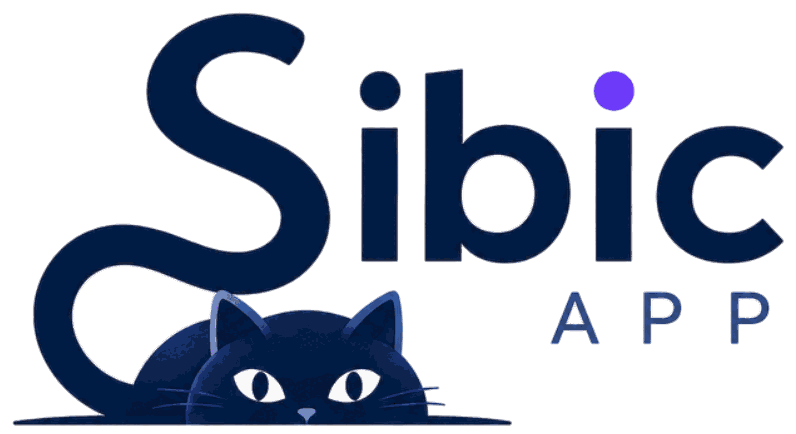

<p align="center">
  
</p>

<p align="center">
  <a href="https://nextjs.org"></a>
  <a href="https://react.dev"></a>
  <a href="https://www.typescriptlang.org"></a>
  <a href="https://tailwindcss.com"></a>
  
</p>

<p align="center">
  Aplicación web progresiva para consultar candidaturas, comparar propuestas y recorrer el contexto de las elecciones desde el celular o el escritorio.
</p>

SIBIC es una progressive web app: se puede instalar en el teléfono o en el escritorio y abrirse como una aplicación. Lee candidatos, temas, propuestas y preguntas desde una hoja de Google. Esa hoja es la fuente de los datos: la aplicación no vuelve a crear filas que se hayan borrado. Las cuentas y las respuestas de Aprende y de Mi Brújula sí se guardan en la hoja cuando alguien inicia sesión o contesta.

## Ejecución

Requiere Node.js 20 o posterior.

```bash
npm install
cp .env.example .env.local
npm run dev
```

Abre [http://localhost:3000](http://localhost:3000).

Completa `.env.local` con el id de la hoja, la cuenta de servicio que tenga acceso a ella y el secreto de autenticación. Las variables están nombradas en `.env.example`.

| Comando | Qué hace |
| --- | --- |
| `npm run dev` | Servidor de desarrollo |
| `npm run build` | Compilación de producción |
| `npm run start` | Sirve la compilación |
| `npm run lint` | Revisa el código |
| `npm run sheets:bootstrap` | Crea las pestañas que falten, solo con encabezados |

`sheets:bootstrap` no escribe candidatos, propuestas ni preguntas. Si una pestaña ya existe, la deja como está.

## Qué incluye

- **Elecciones.** Listado de candidaturas y ficha de cada persona.
- **Compara.** Propuestas agrupadas por tema.
- **Aprende.** Recorrido por secciones, con sesión iniciada.
- **Mi Brújula.** Cuestionario cuyas respuestas quedan ligadas a la persona que las dio.
